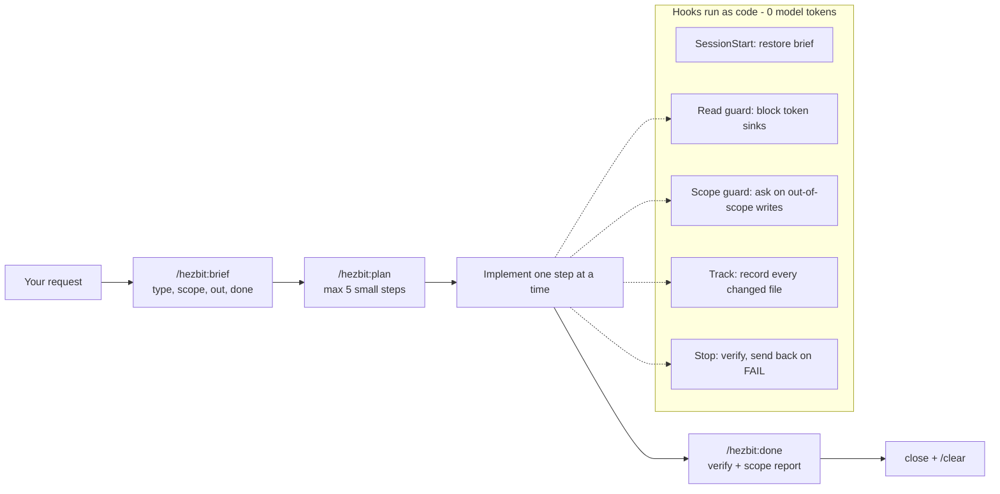

<div align="center">


# Hezbit

### Keep Claude Code pointed at the goal.

**A contract for every task. Guards that enforce it. Checks that prove it.**
The model fills a short form. Scripts do everything else, at zero model tokens.


</div>

---

## The problem

Long coding sessions drift. You ask for a one-line fix and get a refactor. The model re-reads the same 3,000-line file four times, edits a file you never mentioned, forgets *"don't touch the DB"* after a compaction, and says **"done"** without running anything.

Hezbit fixes those four failure modes with code, not with more prompting:

| Drift | What Hezbit does about it |
|---|---|
| Edits outside the task | **Scope guard** asks before any write outside the brief's `scope`, including `sed -i`, `>`, `tee`, `rm`, notebooks |
| Forgotten constraints | Your exact words are saved **verbatim** by a hook and re-injected after `/clear`, resume and compaction |
| Token-burning reads | **Read guard** blocks `node_modules`, `dist`, lock files, minified bundles and huge files read without a line range |
| "Done" with no proof | **Verify** runs your `command :: expected text` checks and the Stop hook sends the model back if they fail |

---

## How it works



**The brief is the contract.** Five lines, written once, approved by you:

```text
type: FIX
scope: src/auth/, tests/auth/
out: no DB schema change; no new dependency
done:
- npm test -- auth :: passed
- manual: POST /login with "huy@exämple.com" returns 200
reply: diff-only, <=10 lines
```

Everything else follows from it: what may change (`scope`), what must not (`out`), how success is proven (`done`), and how the answer should look (`reply`).

---

## Install

**Requirements:** Claude Code, Python 3.8+ on `PATH`. `git` is optional but unlocks shell-edit tracking. On Windows, Git for Windows (Claude Code already needs it for hooks).

### Try it for one session

```bash
git clone https://github.com/hezbdev/hezbit
claude --plugin-dir ./hezbit
```

### Install permanently from GitHub

```text
/plugin marketplace add hezbdev/hezbit
/plugin install hezbit@hezbit
```

> The repository root is the plugin. `.claude-plugin/marketplace.json` lets the same repo act as its own marketplace.

### Check it works

Start Claude Code, type any request such as *"fix the login bug, don't touch the database"*, and you should see:

```text
[hz] no brief. If this task is ambiguous or touches >2 files, run /hezbit:brief first.
```

Add `.claude/hezbit/` to your `.gitignore`. That is where session state lives.

---

## Guide

### 1. Write the brief

```text
/hezbit:brief FIX | login returns 500 when the email has non-ASCII characters
```

Claude picks a `type`, locates `scope` with `hz find` (cheap text search, not a repo scan), asks at most two multiple-choice questions, then writes the brief and runs `hz lint`. Lint rejects a brief that is missing a scope, a `done` item or a `reply`, and one that ignores a *don't / only / except / không / chỉ / trừ* constraint from your request.

You approve it with one word.

### 2. Plan small

```text
/hezbit:plan
```

At most 5 steps, 2 files each, with a check per step. Assumptions are listed and you approve before any code. The plan is saved to disk, so it survives `/clear` and compaction. Each finished step is ticked with a short note.

### 3. Work. The guards stay on

If the model reaches outside `scope`, you get a prompt instead of a surprise:

```text
hezbit: db/schema.sql outside the brief scope (src/auth/).
Allow once, or add it with: hz scope-add <path>
```

Rewriting the brief itself also asks first, so a drifting model cannot quietly widen its own contract.

### 4. Prove it

```text
/hezbit:done
```

```text
Result: INCOMPLETE
1. npm test -- auth       - PASS       - 12 passed
2. POST /login non-ASCII  - MANUAL     - curl returned 200, body ok
Out-of-scope: none
```

Verification has three honest outcomes:

| Status | Meaning | Stop hook |
|---|---|---|
| `PASS` | Every `done` item ran and passed | lets the model finish |
| `FAIL` | A runnable item failed | sends the model back, max 2 tries |
| `INCOMPLETE` | Nothing failed, but something was not checked (manual item, not allowlisted, out of time budget, nothing runnable) | lets the model finish, never reported as PASS |

### 5. Close

On `PASS`, Claude offers to archive the brief (`hz close`). Then `/clear`. The archive keeps your last 10 tasks.

---

## Commands

| Command | What it does |
|---|---|
| `/hezbit:brief [task]` | Turn a request into a checkable brief |
| `/hezbit:plan` | Plan up to 5 steps, wait for approval, execute one at a time |
| `/hezbit:done` | Verify against the brief, report PASS / FAIL / INCOMPLETE, archive |
| `/hezbit:status` | Current brief and plan progress |
| `/hezbit:find <term>` | Locate code by keyword or regex, definitions first, honours `.gitignore` |
| `/hezbit:map` | Compact repo map for orientation |
| `/hezbit:stats` | How many tokens Hezbit itself injected |
| `/hezbit:init-context` | Draft a lean `CLAUDE.md` (under 150 lines) and `.gitignore` suggestions |
| `/hezbit:token-audit` | Scan for token sinks and propose up to 5 fixes |

Also included: the `goal-alignment` skill (the rules the model follows when a `[hz]` line is present) and a read-only `scout` subagent on Haiku for broad exploration, so the main context stays small.

The CLI behind the commands: `hz request | lint | status | plan | next | step | scope-add | check | verify | last | map | find | stats | close | path`.

---

## What the guards actually do

| Guard | Fires on | Behaviour |
|---|---|---|
| **Read guard** | `Read` | **Blocks** dependency and build dirs (relative to your project, so `~/build/myapp` is fine), lock files, `.min.js`, `.map`, and files over 100 KB read without `offset` / `limit`. PDFs and images are exempt |
| **Scope guard** | `Edit` `Write` `MultiEdit` `NotebookEdit` `Bash` | **Asks** before a write outside `scope`. For `Bash` it understands `>` `>>` `tee` `sed -i` `perl -i` `rm` `mv` `cp` `touch` `mkdir` `truncate` `dd of=` `git checkout -- <path>` `git restore` |
| **Contract guard** | any write to Hezbit's own state | **Asks** before the brief or plan is rewritten |
| **Change tracking** | after every tool call, and via `git status` | Records changed files. In a git repo it also sees edits made by *any* means (shell, scripts), relative to a baseline taken at session start, so pre-existing dirt is ignored |
| **Stop hook** | end of turn | Runs verify when files changed. Blocks only on `FAIL`, max twice, then stops and tells you why |

Scope globs behave the way you expect: `*` and `?` stop at `/`, `**` crosses it, a bare `*.py` matches at any depth, and a directory covers everything below it.

**Verify never runs arbitrary code.** Commands run without a shell and only if allowlisted: `npm|pnpm|yarn test`, `run test|lint|typecheck|check|tsc|test:*`, `npx jest|vitest|tsc|eslint`, `pytest`, `python -m pytest|unittest`, `mvn test|verify|compile|package`, `gradle test|check|build`, `go|cargo|dotnet test`, `make test|check|lint`. Everything else is shown as `SKIP`, never as a pass.

---

## Sessions

State lives in `.claude/hezbit/sessions/<session_id>/`, so **two Claude Code sessions on the same repo never overwrite each other's brief, plan or touched files**. Idle sessions are pruned after 14 days. Archive and `stats.log` are shared.

---

## Configuration

| Variable | Default | Effect |
|---|---|---|
| `HEZBIT_ALLOW` | none | Extra auto-run commands, comma separated, matched as whole words: `mytool,./scripts/check` |
| `HEZBIT_MAX_READ_BYTES` | `100000` | Read guard size limit |
| `HEZBIT_VERIFY_BUDGET` | `240` | Total seconds for all verify items (the Stop hook limit is 300) |
| `HEZBIT_SESSION` | latest active | Pin the CLI to one session |

---

## Windows

Hooks are launched through [`scripts/py.sh`](scripts/py.sh), which finds a working `python3`, `python` or `py` (and skips the Microsoft Store stub). Paths with spaces (`C:\Users\Jane Doe\...`), cross-drive paths, 8.3 short names and Vietnamese or other non-ASCII prompts are handled and covered by tests.

---

## Cost, honestly

Hezbit adds a small, fixed cost: about 150 tokens when the brief is injected (once per session start, resume, clear or compact, and again only if the brief changes), plus the brief and plan conversation. Normal prompts add 0. Guards and tracking run as code.

So the trade is deliberate:

- **Small, clear, one-file task:** expect Hezbit to cost *slightly more*. Just do the task without a brief.
- **Large repo, vague request, several files, hard constraints:** this is where avoiding wasted reads, drift and rework can pay off.

Don't take our word for it. Measure on your own repo:

```bash
python bench/ab.py my-tasks.json --repo <repo> --runs 5 --arms base,seeded
```

[`bench/ab.py`](bench/ab.py) runs the same tasks with and without the plugin in clean git worktrees and reports cost, tokens, turns, **success rate, out-of-scope edits and cost per successful task**. Start from [`bench/tasks.example.json`](bench/tasks.example.json). Real runs bill your account, so start with `--runs 1`.

A first smoke run on a tiny task (1 run per arm) showed the plugin costing about 13% more, as predicted for small tasks. It proves nothing about large ones. That is what the benchmark is for.

---

## Limits

- Scope guard and tracking see `Bash` through heuristics. They cannot parse `python -c`, `node -e` and similar. In a git repo the Stop hook and `hz check` still catch those through `git status`.
- Outside a git repo, only edit tools and recognised shell commands are tracked.
- `hz find` is text search, not a symbol index. The constraint check in `lint` is keyword based and may over-warn.
- `pytest`, `mvn`, `gradle` and `make` run project code by nature. Keep `HEZBIT_ALLOW` tight and review test config like any other code.
- Edits made to a file outside the project directory are not scoped.

---

## Project layout

```text
hezbit/
├── .claude-plugin/     plugin.json, marketplace.json
├── commands/           /hezbit:* slash commands
├── skills/             goal-alignment rules
├── agents/             scout (read-only, Haiku)
├── hooks/hooks.json    six hooks, all launched via scripts/py.sh
├── scripts/            hz.py CLI, glib.py core, one script per hook
├── bench/              A/B benchmark harness
└── tests/              34 tests: python -m unittest discover -s tests
```

## Develop

```bash
python -m unittest discover -s tests          # 34 tests, standard library only
claude --plugin-dir .                         # try your changes live
```

No dependencies. No build step. The hooks are plain Python 3 standard library.
